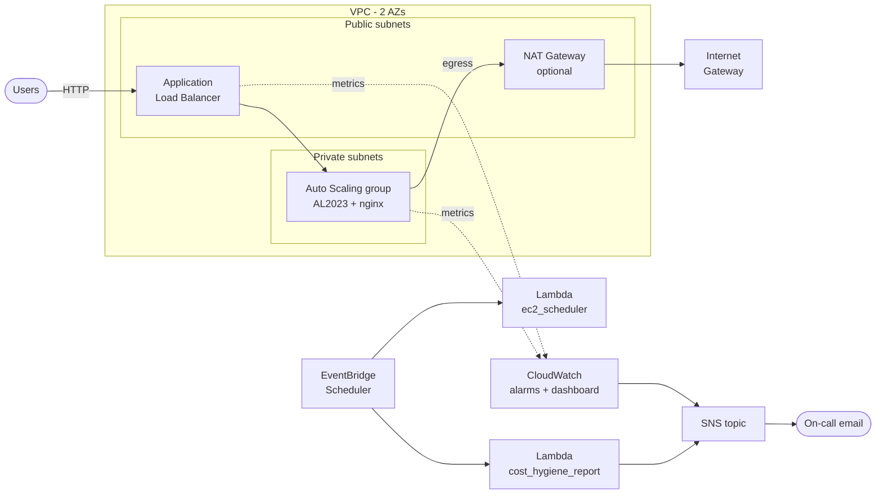

# aws-lab

[](https://github.com/Arjunmore88/aws-lab/actions/workflows/ci.yml)


Highly available, secure, monitored and cost-controlled web hosting on AWS,
built with **CloudFormation**, the **AWS CLI** and **Python (boto3) Lambda**
automation.

## Scenario

> A small company is moving its web app to AWS and wants it highly available,
> secure, monitored and cost-controlled.

This repository is the infrastructure and operations work for that migration:
a multi-AZ network, a load-balanced auto-scaling web tier, alarms that page a
human with a runbook link, scheduled automation that keeps the bill in check,
least-privilege IAM, and a CI pipeline that lints and tests every change.

## Architecture



More detail, an ASCII version, design trade-offs and a cost breakdown are in
[docs/architecture.md](docs/architecture.md).

## What's covered

| Area | Implementation | Where |
|---|---|---|
| Networking | VPC, 2 public + 2 private subnets across 2 AZs, IGW, single NAT Gateway (toggleable), route tables, free S3 gateway endpoint | [`cloudformation/network.yaml`](cloudformation/network.yaml) |
| Compute and HA | Internet-facing ALB, target group with `/health` check, launch template (AL2023 via SSM parameter, IMDSv2, encrypted gp3, nginx user data), ASG in private subnets with CPU target tracking and rolling updates | [`cloudformation/app.yaml`](cloudformation/app.yaml) |
| Security | ALB SG open on :80, instance SG accepts traffic only from the ALB SG, no SSH (SSM Session Manager), instance role with `AmazonSSMManagedInstanceCore` | [`cloudformation/app.yaml`](cloudformation/app.yaml) |
| Monitoring | SNS topic + email subscription, alarms for ALB 5xx / unhealthy hosts / ASG CPU, operations dashboard | [`cloudformation/monitoring.yaml`](cloudformation/monitoring.yaml) |
| Automation | Python 3.12 Lambdas on EventBridge Scheduler with least-privilege roles | [`lambda/`](lambda/), [`cloudformation/automation.yaml`](cloudformation/automation.yaml) |
| Cost control | Office-hours EC2 stop/start, weekly report of unattached EBS, idle EIPs and old snapshots, NAT toggle, cost allocation tags | [`lambda/`](lambda/), [`docs/architecture.md`](docs/architecture.md#cost-estimate) |
| IAM | Example least-privilege policies: developer read-only + tag-scoped SSM sessions, S3 prefix-scoped access, region guardrail | [`iam/`](iam/) |
| Operations | Runbooks for ALB 5xx, unhealthy ASG instances, unexpected bill spike | [`runbooks/`](runbooks/) |
| Delivery | `deploy.sh` / `destroy.sh` wrappers around `aws cloudformation deploy` | [`scripts/`](scripts/) |
| Quality | cfn-lint, pytest + moto unit tests, ShellCheck in GitHub Actions | [`.github/workflows/ci.yml`](.github/workflows/ci.yml), [`tests/`](tests/) |

All resources carry `Project`, `Environment`, `Owner` and `CostCenter` tags.

## Repository layout

```
aws-lab/
├── cloudformation/
│   ├── network.yaml          # VPC, subnets, IGW, NAT, routes, exports
│   ├── app.yaml              # ALB, target group, launch template, ASG, SGs, IAM
│   ├── monitoring.yaml       # SNS, CloudWatch alarms, dashboard
│   └── automation.yaml       # Lambda functions, IAM, EventBridge Scheduler
├── lambda/
│   ├── ec2_scheduler/handler.py
│   └── cost_hygiene_report/handler.py
├── iam/                      # Example least-privilege policies + README
├── scripts/
│   ├── deploy.sh
│   └── destroy.sh
├── runbooks/
│   ├── alb-5xx-errors.md
│   ├── asg-unhealthy-instances.md
│   └── unexpected-bill-spike.md
├── docs/
│   └── architecture.md
├── tests/                    # pytest + moto unit tests for both Lambdas
├── .github/workflows/ci.yml
├── requirements-dev.txt
└── LICENSE
```

## Prerequisites

- An AWS account you are allowed to create billable resources in
- [AWS CLI v2](https://docs.aws.amazon.com/cli/latest/userguide/getting-started-install.html)
  configured with credentials (`aws sts get-caller-identity` should succeed)
- Permissions to create VPC, EC2, ELB, Auto Scaling, IAM roles, CloudWatch,
  SNS, Lambda, EventBridge Scheduler and S3 resources
- `bash`, `python3` (3.12 recommended) for packaging and local tests

## Deploy

```bash
git clone https://github.com/Arjunmore88/aws-lab.git
cd aws-lab

# All four stacks, in order: network -> app -> monitoring -> automation
./scripts/deploy.sh -e dev -r ap-south-1 --alert-email you@example.com
```

Confirm the SNS subscription email, then open the `Application URL` the script
prints. Refreshing the page shows responses from instances in different AZs.

Useful options:

```bash
./scripts/deploy.sh --help
./scripts/deploy.sh -e dev -r ap-south-1 --no-nat                # cheaper, no NAT Gateway
./scripts/deploy.sh -e dev -r ap-south-1 --only "network app"    # subset of stacks
```

Each stack can also be deployed by hand, for example:

```bash
aws cloudformation deploy \
  --stack-name aws-lab-dev-network \
  --template-file cloudformation/network.yaml \
  --parameter-overrides Environment=dev EnableNatGateway=true \
  --tags Project=aws-lab Environment=dev Owner=platform-team CostCenter=CC-1001
```

### Try the automation

```bash
# Opt an instance in to the office-hours schedule
aws ec2 create-tags --resources i-0123456789abcdef0 --tags Key=Schedule,Value=office-hours

# Run the functions on demand
aws lambda invoke --function-name aws-lab-dev-ec2-scheduler \
  --cli-binary-format raw-in-base64-out --payload '{"action":"stop"}' /dev/stdout
aws lambda invoke --function-name aws-lab-dev-cost-hygiene-report /dev/stdout
```

The scheduler is intended for standalone dev/test instances. Do not tag
instances that belong to an Auto Scaling group - the ASG would treat a stopped
instance as unhealthy and replace it. Scale an ASG down with its desired
capacity instead.

## Teardown

```bash
./scripts/destroy.sh -e dev -r ap-south-1 --delete-artifacts
```

Stacks are deleted in reverse order (automation -> monitoring -> app -> network)
because later stacks import exports from earlier ones.

> **Cost warning:** the NAT Gateway and the Application Load Balancer bill by
> the hour whether or not they receive traffic. With default settings this lab
> costs roughly **2.70 USD per day (about 80 USD per month)**. Destroy the
> stacks as soon as you are finished. See the
> [cost estimate](docs/architecture.md#cost-estimate).

## Local development and CI

```bash
python3 -m venv .venv && source .venv/bin/activate
pip install -r requirements-dev.txt

cfn-lint cloudformation/*.yaml     # template linting
pytest                             # Lambda unit tests against moto (no AWS calls)
shellcheck scripts/*.sh            # shell script linting
```

The same three checks run in GitHub Actions on every push and pull request.

## Skills demonstrated

- **Infrastructure as Code with CloudFormation** - parameters, conditions,
  mappings, cross-stack exports/`Fn::ImportValue`, update policies, metadata
  interface, and stack ordering
- **AWS networking** - multi-AZ VPC design, public/private subnet tiers, NAT vs
  gateway endpoints, route tables, security group chaining
- **High availability and scaling** - ALB health checks, ELB-based ASG health,
  target tracking, rolling updates
- **Security** - least-privilege IAM, tag-based (ABAC) conditions, IMDSv2,
  SSM Session Manager instead of SSH, encrypted storage
- **Observability** - CloudWatch metrics, metric math alarms, dashboards, SNS
  alerting, runbook-driven incident response
- **Automation with Python and boto3** - paginated API calls, env-var
  configuration, logging, type hints, dry-run mode, EventBridge Scheduler
- **Cost management** - cost drivers, scheduling, hygiene reporting, tagging
  for cost allocation
- **Testing and CI** - pytest with moto, cfn-lint, ShellCheck, GitHub Actions
- **AWS CLI and Bash** - defensive scripting (`set -euo pipefail`, argument
  parsing, `--help`)

## Author

**Arjun More** - [github.com/Arjunmore88](https://github.com/Arjunmore88)

## License

[MIT](LICENSE)
