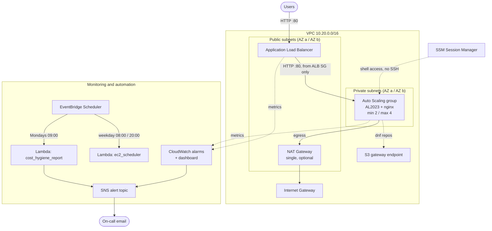

# Architecture

## Overview



ASCII equivalent for terminals:

```
                     Internet
                        |
                 [ Internet Gateway ]
                        |
   +--------------------+---------------------------- VPC 10.20.0.0/16 ---+
   |  Public 10.20.0.0/24 (AZ a)        Public 10.20.1.0/24 (AZ b)         |
   |   [ ALB node ]  [ NAT GW ]          [ ALB node ]                       |
   |        |            ^                    |                             |
   |        v            |                    v                             |
   |  Private 10.20.10.0/24 (AZ a)      Private 10.20.11.0/24 (AZ b)       |
   |   [ EC2 nginx ] ----+               [ EC2 nginx ] --(via NAT in AZ a)  |
   |        \______________ Auto Scaling group (ELB health checks) ___/      |
   +-------------------------------------------------------------------------+
        CloudWatch alarms -> SNS -> email      EventBridge Scheduler -> Lambda
```

## Stacks and dependencies

Stacks are deployed in order and wired together with CloudFormation exports
named `<project>-<env>-<Name>`, so several environments can live in one account.

| Order | Stack | Template | Exports used by later stacks |
|---|---|---|---|
| 1 | `aws-lab-<env>-network` | `cloudformation/network.yaml` | `VpcId`, `PublicSubnetIds`, `PrivateSubnetIds` |
| 2 | `aws-lab-<env>-app` | `cloudformation/app.yaml` | `AlbFullName`, `TargetGroupFullName`, `AsgName` |
| 3 | `aws-lab-<env>-monitoring` | `cloudformation/monitoring.yaml` | `AlertTopicArn` |
| 4 | `aws-lab-<env>-automation` | `cloudformation/automation.yaml` | - |

CloudFormation blocks deleting a stack while another stack imports its
exports, which is why `scripts/destroy.sh` tears down in reverse order.

## Design decisions

**High availability**
- Two AZs for every tier. The ALB is cross-zone by default, and the ASG keeps
  `MinSize=2` so there is one instance per AZ at all times.
- ASG health checks use the ALB target health (`HealthCheckType: ELB`), so an
  instance whose nginx is down is replaced, not just one whose hardware failed.
- Rolling updates replace one instance at a time with at least one in service.
- **Known trade-off:** a single NAT Gateway in AZ a. If AZ a fails, instances in
  AZ b keep serving traffic through the ALB but lose outbound internet access.
  Production would use one NAT Gateway per AZ (about +32 USD/month each).

**Security**
- Instances have no public IPs and sit in private subnets.
- Security group chaining: the instance SG only accepts port 80 from the ALB SG.
- No SSH. Shell access goes through SSM Session Manager (instance role has
  `AmazonSSMManagedInstanceCore`), which is IAM-authorised and logged in CloudTrail.
- IMDSv2 required (`HttpTokens: required`, hop limit 1) to mitigate SSRF
  credential theft.
- EBS root volumes encrypted; ALB drops invalid header fields.
- Lambda roles are least privilege: the scheduler can only start/stop instances
  carrying `Schedule=office-hours`; the cost report has read-only describe
  calls and `sns:Publish` to a single topic; log permissions are scoped to each
  function's own log group.
- **Lab simplification:** the listener is HTTP only. Production would add an
  ACM certificate, an HTTPS listener and an HTTP->HTTPS redirect, and
  optionally AWS WAF on the ALB.

**Scaling**
- Target tracking on `ASGAverageCPUUtilization` (default 50%) - AWS manages
  the scale-out/scale-in alarms. A separate `asg-cpu-high` alarm notifies
  humans if CPU stays high, which typically means `MaxSize` has been reached.

**Monitoring**
- Alarms: ALB 5xx (ELB + target, metric math), unhealthy hosts, ASG CPU high.
  Each alarm description links its runbook. Both `ALARM` and `OK` transitions
  notify, so on-call knows when an issue has cleared.
- Dashboard: requests, 4xx/5xx, p95 latency, healthy/unhealthy hosts, CPU,
  in-service vs desired instances, alarm status.

## Cost estimate

Approximate on-demand prices for `ap-south-1` / `us-east-1` with default
parameters, as of 2026. Always confirm with the
[AWS Pricing Calculator](https://calculator.aws/) for your region.

| Component | Basis | ~USD / month |
|---|---|---|
| NAT Gateway | 0.045/hour + 0.045/GB processed | 33 + data |
| Application Load Balancer | 0.0225/hour + LCUs | 17 + LCU |
| EC2 t3.micro x 2 | 0.0104/hour each | 15 |
| Public IPv4 addresses | ALB (2) + NAT EIP, 0.005/hour each | 11 |
| EC2 detailed monitoring | 7 metrics x 2 instances | 4 |
| EBS gp3 8 GiB x 2 | 0.08/GB-month | 1.3 |
| CloudWatch alarms + dashboard | 3 alarms, 1 dashboard (first 3 free) | < 1 |
| Lambda + EventBridge Scheduler | a few hundred invocations | ~0 (free tier) |
| SNS email | a handful of notifications | ~0 |
| **Total (NAT enabled)** | | **~80 / month, ~2.70 / day** |
| **Total (`--no-nat`)** | | **~45 / month** |

Cost levers used in this design:

- `EnableNatGateway=false` removes the most expensive line item when private
  instances do not need general internet access. The free S3 gateway endpoint
  still lets AL2023 reach its package repositories, but SSM Session Manager
  will not work without NAT (or SSM interface endpoints, which cost about
  7 USD/month each per AZ).
- `ec2_scheduler` stops tagged non-production instances outside office hours
  (12 hours x 5 days = 60 of 168 hours, about 64% less compute for those instances).
- `cost_hygiene_report` surfaces unattached volumes, idle Elastic IPs and old
  snapshots every week.
- Consistent `Project` / `Environment` / `Owner` / `CostCenter` tags make spend
  attributable in Cost Explorer once activated as cost allocation tags.

**For a learning lab, deploy, test, and destroy the same day - a lab left
running for a month costs about the same as a month of a small production app.**
